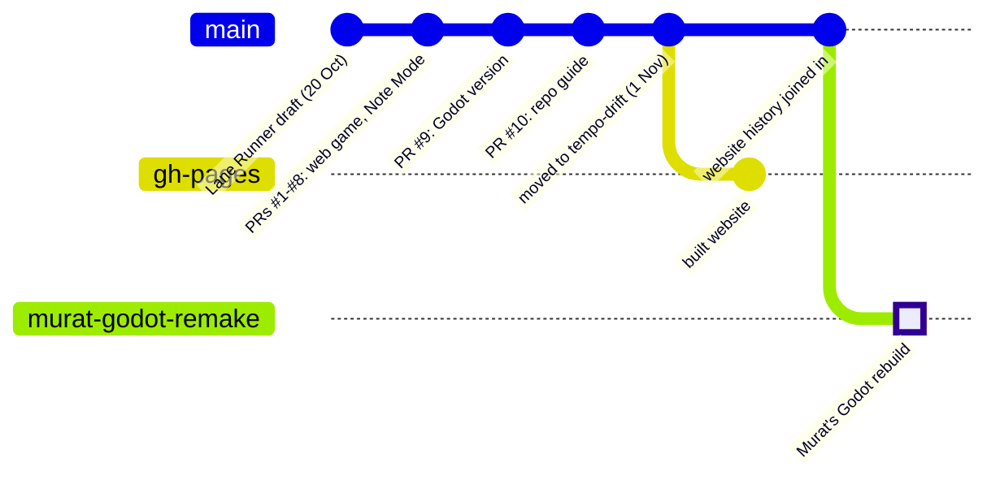

# Tempo Drift

A flying-car rhythm game for iPhone, built by [@reha-abbasi](https://github.com/reha-abbasi) and
[@muratbyk](https://github.com/muratbyk). Fly through three eras of eight real cities each. Every note of the song is a
ring: swipe into its lane or height on the beat. Goal: publish on the Apple App Store.

## Play it

| Version | Play | Source |
|---|---|---|
| **Godot version, Murat's rebuild** (becoming the main version) | https://reha-abbasi.github.io/tempo-drift/godot/murat/ | branch [`murat-godot-remake`](https://github.com/reha-abbasi/tempo-drift/tree/murat-godot-remake), project in `godot/` |
| **Godot version, Reha's** | https://reha-abbasi.github.io/tempo-drift/godot/ | [`godot/game/`](godot/game) on `main`, guide in [`godot/README.md`](godot/README.md) |
| **Web version** (the original, one HTML file) | https://reha-abbasi.github.io/tempo-drift/ | [`web/game.html`](web/game.html), iPhone app shell in [`web/app/`](web/app) |

On iPhone: open a link in Safari. The web version can be added to the home screen (Share → Add to Home Screen).

## The game

- **Three eras, 24 cities.** The Past (London 1890 to Rome 1948, swing band), the Present (Dubai to Reykjavík) and the
  Future (Hong Kong 2049 to Las Vegas 2099). Each city has its own street, light, landmark and song.
- **Rings on the beat.** Each melody note is a ring in one of three lanes and three heights. Swipe left and right to
  change lanes, up to hop, down to dive. Timing grades: EXCELLENT, GOOD, OK.
- **Two lives.** Crash once and you bail out of the car onto a jetpack; catch notes to be rescued back into a car.
- **Flow and Overdrive.** Clean streaks raise the multiplier and bring in more of the band.
- **Garage.** Cars with perks and pilots with their own lead instrument, bought with the coins you earn.
- **Stars, missions, a daily gift, Flight School** to learn the moves, and **Endless** mode.

## Working on it

Built with **[Godot 4.7.2](https://godotengine.org/download/archive/4.7.2-stable/)** (standard, not .NET): free, exports
to iPhone, and its files are plain text, so two people can work on it in git.

1. Clone the repo: `git clone https://github.com/reha-abbasi/tempo-drift.git`
2. In Godot, click **Import** and pick the project: `godot/game/project.godot` on `main`, or `godot/project.godot` on
   the `murat-godot-remake` branch.
3. Press **F5** to play. On a computer the mouse drags like a finger, and the arrow keys or WASD also steer.

Godot's `.godot/` cache isn't in git; it's rebuilt the first time you open the project.

**Working together:** `git pull` first, make a branch for your change (`git switch -c my-change`), push it and open a
pull request; the other person reviews and merges it. Try not to edit the same scene file at the same time.

**Getting it onto an iPhone as an app** needs a Mac with Xcode, and the Apple Developer Program ($99 a year) for
TestFlight and the App Store. Until then, the play links above run in Safari.

## Branches

| Branch | What it is | Status (1 Nov 2026) |
|---|---|---|
| [`main`](https://github.com/reha-abbasi/tempo-drift/tree/main) | All the source code (this page) | The main version |
| [`murat-godot-remake`](https://github.com/reha-abbasi/tempo-drift/tree/murat-godot-remake) | Murat's rebuild of the Godot game from web game v26: every level is a scene you can edit in Godot | **Planned to become `main`** after a music upgrade |
| [`gh-pages`](https://github.com/reha-abbasi/tempo-drift/tree/gh-pages) | The website: the built games at the play links above | Updated by the publish scripts. Never merged into `main` |
| `murat-welcome-text` | Murat's welcome line on the menu (pull request #1) | Merged 24 Oct, can be deleted |
| `murat-v20-the-band` | Murat's v20 The Band (pull request #2) | Merged 24 Oct, can be deleted |

**What the planned merge changes in `main`:** the web game (`web/`) stays. Murat's project replaces `godot/game/` and
`godot/tools/`; the Lane Runner files, `docs/` and the Godot web publishing tools come off `main`. Nothing is lost: all
of it stays in the history.

## Where things are on `main`

| Folder | What's in it |
|---|---|
| [`godot/game/`](godot/game) | Reha's Godot version: scripts, shaders, course data, music |
| [`godot/tools/`](godot/tools) | Tools that make the courses and the music |
| [`web/`](web) | The web version and its iPhone app shell |
| [`tools/`](tools) | Build and publish scripts for the website (they update the `gh-pages` branch) |
| [`docs/`](docs) | [`START-HERE.md`](docs/START-HERE.md): git and the folders explained in plain language |
| top folder: `project.godot`, `scenes/`, `scripts/`, `shaders/`, `assets/`, `tests/` | **Lane Runner**, the first draft (below) |

## History: Lane Runner

The project started on 20 October 2026 as **Lane Runner**, a 3-lane endless runner in the style of Subway Surfers.
On 21 October it turned into Tempo Drift, the flying-car rhythm game. Lane Runner's files are still in the top folder of
`main` and will come off with the planned merge; they stay in the history.

The code lived in a private repo, `runner-game`, until 1 November 2026, when it moved here with its whole history.
