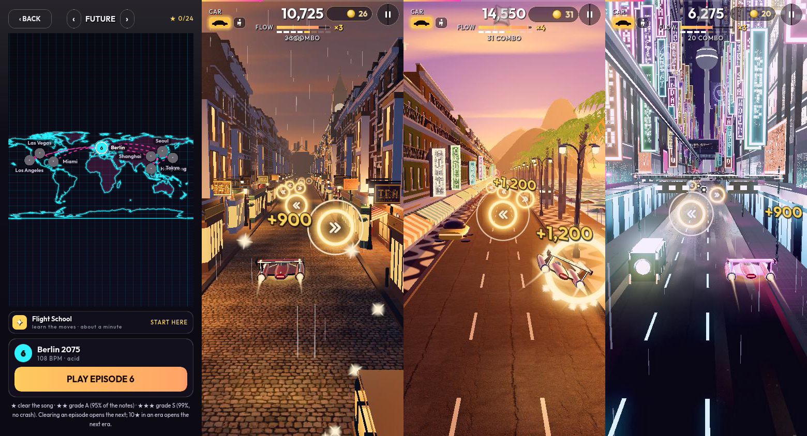

# Tempo Drift

A flying-car rhythm runner for iPhone by [@reha-abbasi](https://github.com/reha-abbasi) and
[@muratbyk](https://github.com/muratbyk). Fly through 24 cities across three eras, swiping into a ring on every note
of the song.

**Current version: v29 Brass & Swing** (2 Nov 2026). What changed in each version: [`PATCH-NOTES.md`](PATCH-NOTES.md).

> **New music, one city at a time.** The music is being remade city by city. Two cities are open so far: **Berlin 2075**,
> with melodic techno and an 80s synth-brass melody (the menus play it too), and **London 1890**, with a swinging
> acoustic pub band. The other 22 cities are still on the map, locked, and open one by one as their new music is made. The old music is taken out. The tools that make the
> music are in [`godot/tools/music/`](godot/tools/music).
>
> What changed in each update: [`PATCH-NOTES.md`](PATCH-NOTES.md).

This repo holds two versions of the same game:

| Version | Folder | Open or play it |
|---|---|---|
| **Godot** (the one to build on) | [`godot/`](godot) | Open `godot/project.godot` in [Godot 4.7.2](https://godotengine.org/download/archive/4.7.2-stable/). Guide: [`godot/README.md`](godot/README.md) |
| **Web** (the original, one HTML file) | [`web/`](web) | https://reha-abbasi.github.io/tempo-drift/ · edit `web/game.html` |

The Godot version started from the web version's rules: the same rules, menus, garage, map and missions. Its courses were made by running the web game's own code
(`godot/tools/bake/`); its music is now being remade city by city with `godot/tools/music/`.

## Open the Godot version

1. Install **Godot 4.7.2** (standard, not .NET).
2. In Godot's Project Manager: **Import** → pick `godot/project.godot` → **Import & Edit**. The first import takes a
   few minutes.
3. Press **F5** to play from the start (intro, then menus), or open a level from `godot/scenes/levels/` and press
   **F6** to fly just that level.

## The other folders

- `web/`: the web game and its iPhone home-screen version (`web/app/`), see [`web/README.md`](web/README.md).
- `tools/`: the scripts that make and publish that iPhone version, see [`tools/README.md`](tools/README.md).

The `gh-pages` branch is the published web game; the publish script updates it.

## Branches

| Branch | What it is |
|---|---|
| `main` | The game (this page): Murat's Godot version with the new music |
| `gh-pages` | The website: the built games at https://reha-abbasi.github.io/tempo-drift/ (updated by the publish scripts, never merged into `main`) |
| `murat-godot-remake`, `music-test-berlin` | Merged into `main` on 1 Nov 2026 |
| `murat-welcome-text`, `murat-v20-the-band` | Merged on 24 Oct 2026 |

Before 1 Nov 2026 `main` held Reha's own Godot version (`godot/game/`) and the first Lane Runner draft; they are still in
the history.
