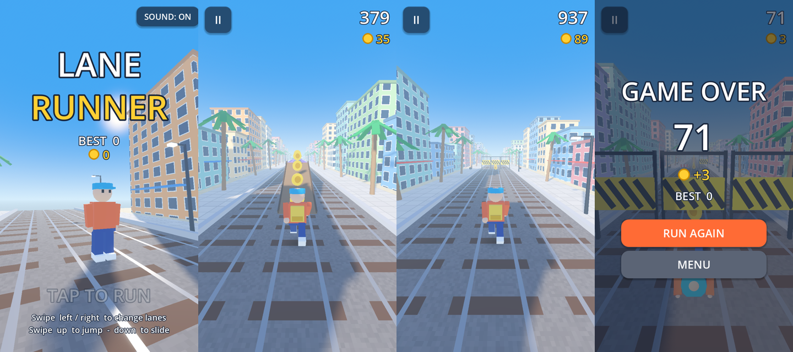

# Tempo Drift (and the original Lane Runner)

## Where everything is

Everything is in this one repo, [reha-abbasi/tempo-drift](https://github.com/reha-abbasi/tempo-drift):

- **`main` branch: all the source code.** Edit this.
- **`gh-pages` branch: the built game** that GitHub Pages serves at the play links below. Don't edit it by hand: the
  publish scripts in `tools/` overwrite it.

(The code used to live in a separate private repo, `runner-game`. It moved here with its whole history.)

| What | Source (edit this) | Play it |
|---|---|---|
| **Tempo Drift, Godot version** (the main project now) | [`godot/game/`](godot/game) (scripts, shaders, course data, music). Tools that make the courses and music: [`godot/tools/`](godot/tools). Guide: [`godot/README.md`](godot/README.md) | https://reha-abbasi.github.io/tempo-drift/godot/ |
| **Tempo Drift, web version** (the original, one HTML file) | [`web/game.html`](web/game.html), iPhone app shell in [`web/app/`](web/app) | https://reha-abbasi.github.io/tempo-drift/ |
| **Lane Runner** (the first draft, described below) | the root folder: `project.godot`, `scenes/`, `scripts/`, `shaders/` | — |

Not in git: Godot's `.godot/` cache (rebuilt when you open the project) and `godot/previews/` (music preview mp3s).

To work on the Godot version, open `godot/game/project.godot` in Godot 4.7.2, not the `project.godot` in the root
folder (that one is Lane Runner).

---

A 3-lane endless runner for iPhone in the style of Subway Surfers / Temple Run, built by
[@reha-abbasi](https://github.com/reha-abbasi) and [@muratbyk](https://github.com/muratbyk).
Goal: publish on the Apple App Store.

**New to coding or git?** Read [`docs/START-HERE.md`](docs/START-HERE.md) first. It explains the words, the folders and
the common jobs in plain language. Each folder also has a `README.md` saying what's in it.

Built with **[Godot 4.7.2](https://godotengine.org/download/archive/4.7.2-stable/)**: free, open source, exports to iOS,
and its scene/script files are plain text, so two people can work on it in git without constant merge conflicts.



## What's in this first draft

- Endless 3-lane track that speeds up over time (14 m/s up to 32 m/s)
- **Swipe** left/right to change lanes, **up** to jump, **down** to slide (down in the air = slam down)
- Obstacles: low hurdles (jump), overhead signs (slide), trains (dodge), and trains with **ramps** you can run up and along the roof
- Bumping something from the side = stumble ("CAREFUL!"); a second bump within 4 s ends the run
- Coins (lines and jump arcs), **Magnet** and **x2 Score** power-ups
- Score, coin count, saved best score and coin bank, pause, game over and run again, sound toggle
- Auto-pause when the app goes to the background, safe-area margins for the iPhone notch, haptic buzz on crash
- Placeholder art made from simple shapes, plus generated chiptune music and sound effects, all meant to be replaced

## Do I need to download Godot?

**Just to play or test the game: no.** Open the web preview in any phone or computer browser:
https://claude.ai/artifact/HmgViG5EE7wUr46QJXHNBE (ask Reha to share it with you).
It shows the latest version merged into `main`, after someone republishes it (see *Updating the shared web preview* below).

**To change the code and see your change working,** something has to turn the code into a playable game.
That's Godot's job, but it doesn't have to run on your computer:

| Option | Need to download? | Good for | Status |
|---|---|---|---|
| **A. Godot on your computer** (recommended for regular work) | Yes, free, about 100 MB, no installer: unzip and run | Fastest: press F5 and see a change in seconds | Ready, see below |
| **B. Auto-preview on GitHub.** GitHub builds the game for every pull request and posts a link to play that version | No. You can even edit code on the GitHub website | Testing a change without Godot or Claude | Not set up yet. Needs a free Netlify or Cloudflare Pages account. Preview links are public but random |
| **C. Claude in the cloud** (claude.ai/code). Ask it to *"update the web preview"* and Claude downloads Godot onto its own cloud machine | No | Updating the shared preview link | Needs a Claude plan and edit access to the preview. Not tested yet |
| **D. GitHub Codespaces.** A cloud computer in your browser with everything installed | No | Full setup without installing anything | Not set up yet. Free for about 60 hours a month. More technical |

Ask Claude to set up B, C or D when you want one.

## How to play it on your computer

1. Download **Godot 4.7.2 (standard, not .NET)** from https://godotengine.org/download/archive/4.7.2-stable/
   (Windows: unzip and run the `.exe`. Mac: drag to Applications).
2. Clone this repo: `git clone https://github.com/reha-abbasi/tempo-drift.git`
3. Open Godot, click **Import**, pick the `project.godot` file in the cloned folder.
4. Press **F5** (or the ▶ button at the top right).

Desktop controls: **arrow keys** or **WASD**, Space = jump, Esc/P = pause, Enter = start.
You can also click and drag with the mouse to "swipe".

## Getting it onto an iPhone

Apple requires a **Mac with Xcode** to build an iPhone app, for testing and for the App Store.

1. On a Mac: install **Xcode** (free, App Store) and Godot 4.7.2.
2. In Godot: *Editor > Manage Export Templates > Download and Install*.
3. *Project > Export > iOS*: set your **App Store Team ID** and a unique **Bundle Identifier**
   (e.g. `com.yourname.lanerunner`). The preset is already in `export_presets.cfg`.
4. Export, open the generated `.xcodeproj` in Xcode, plug in the iPhone, press Run.
   A free Apple ID can install on your own phone for 7 days at a time.
5. For TestFlight / the App Store you need the **Apple Developer Program** ($99/year).

There is also a **Web** export preset (`Project > Export > Web`), handy for quick tests in a phone browser.

## Updating the shared web preview (Claude artifact)

We keep a private browser copy of the game at https://claude.ai/artifact/HmgViG5EE7wUr46QJXHNBE
(open it on a phone to test). Anyone with **edit** access to that artifact can update it from a Claude Code session:

1. `git pull` on `main` so the preview matches the merged code.
2. Build the preview files (needs Godot 4.7.2 and its export templates, see *Getting it onto an iPhone* step 2):
   ```bash
   tools/web_preview.sh build/web_artifact /path/to/godot
   ```
   Step-by-step version for non-coders: [`tools/README.md`](tools/README.md).
   This exports the Web preset and runs `tools/web_artifact.py`, which splits the engine file into parts under 15 MB
   and renames `index.pck` to `index.pck.wasm`, because artifacts only accept smaller files with known extensions.
3. Ask Claude: *"Publish `build/web_artifact/index.html` with all the other files in that folder as supporting files,
   to the existing artifact https://claude.ai/artifact/HmgViG5EE7wUr46QJXHNBE."*

`build/` is in `.gitignore`, so the generated files never get committed.

## Project layout

```
project.godot          engine settings (portrait 720x1280, Mobile renderer)
scenes/main.tscn       the one scene: camera, light, sky, Track, Player, HUD
scripts/
  game.gd              game states, swipe/keyboard input, collisions, score, camera
  player.gd            lanes, jump/slide physics, procedural run animation, character model
  track.gd             spawns/scrolls obstacles, coins, power-ups and scenery
  patterns.gd          ★ the obstacle layouts. Add new ones here
  obstacle.gd          collision data for an obstacle (boxes + walkable surfaces)
  world_kit.gd         builds the placeholder 3D art (trains, hurdles, buildings, palms…)
  mesh_kit.gd          shape/material helpers
  hud.gd               all UI: menu, HUD, pause, game over
  config.gd            ★ tuning numbers (speeds, jump height, timings…)
  autopilot.gd         a bot that plays the game (for automated testing)
  save_data.gd, sfx.gd autoloads: saved stats, sound
shaders/               ground (tracks/sidewalk) and building-window shaders
assets/audio/          placeholder sounds (made by tools/make_audio.py)
tests/run_tests.gd     gameplay tests
tools/                 audio generator, screenshot script, web preview packager
```

The world scrolls toward the camera and the player stays at z = 0, so numbers never get huge on long runs.
Collisions are simple boxes checked in `game.gd`, not the physics engine, which keeps them predictable.

## Testing

```bash
# gameplay tests (jump over hurdle, slide under sign, ramps, side bumps, coins…)
godot --headless --path . --script res://tests/run_tests.gd

# let the bot play 10 runs of up to 5 minutes. Every pattern should be beatable
godot --headless --path . --fixed-fps 60 -- --autoplay --runs=10 --max-time=300

# sanity check: a runner that never steers must crash quickly
godot --headless --path . --fixed-fps 60 -- --autoplay --no-bot --runs=3
```

## Working together

1. `git pull` before you start.
2. Make a branch for your change: `git switch -c my-feature`
3. Commit, `git push -u origin my-feature`, then open a Pull Request on GitHub.
4. The other person reviews and merges it into `main`.

Tips: avoid editing `scenes/main.tscn` at the same time as your partner (scene files merge less cleanly than scripts),
and don't commit the `.godot/` folder (it's in `.gitignore`).

## Ideas / next steps

- [ ] Real character + obstacle 3D models (e.g. from Kenney.nl / Quaternius, free) or commissioned art
- [ ] Theme & name (city? beach? Oceanside?)
- [ ] A chaser (Subway's inspector) after the first stumble
- [ ] Moving trains, more obstacle patterns, more power-ups (jetpack, super sneakers)
- [ ] Shop: spend coins on characters/boards, daily missions, score multiplier upgrades
- [ ] Real music + sound effects
- [ ] Leaderboards (Game Center), achievements
- [ ] App icon, launch screen, App Store screenshots, privacy policy
